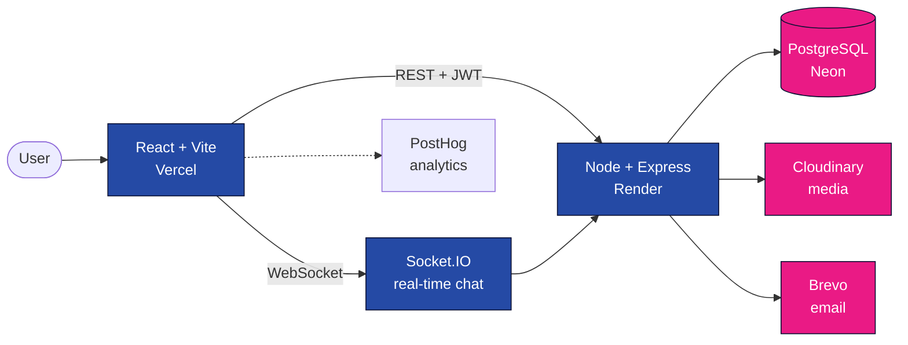
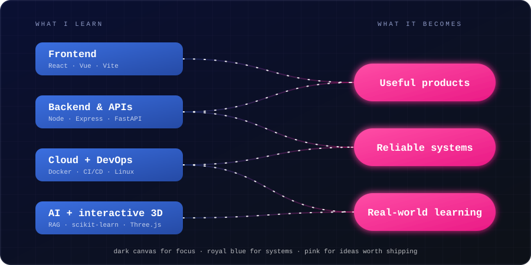
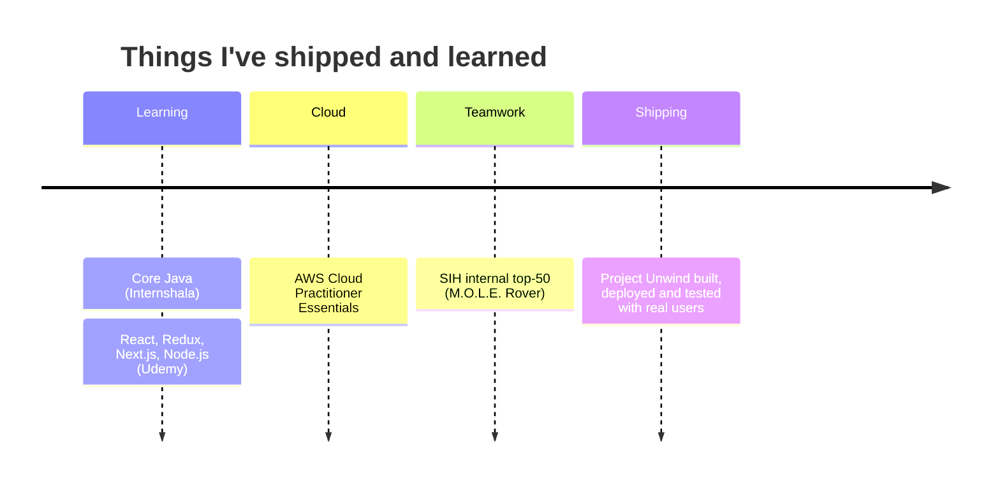

<div align="center">

<a href="https://github.com/AtharvaPadwal2">

</a>

<a href="https://github.com/AtharvaPadwal2">

</a>

<br/>

<a href="mailto:atharvapadwal520@gmail.com"></a>
<a href="https://project-unwind-mu.vercel.app/"></a>
<a href="https://ar-tifact-six.vercel.app/"></a>
<a href="https://github.com/AtharvaPadwal2"></a>

<br/><br/>

**[About](#about)** &nbsp;•&nbsp; **[Projects](#projects)** &nbsp;•&nbsp; **[Stack](#stack)** &nbsp;•&nbsp; **[Stats](#stats)** &nbsp;•&nbsp; **[Journey](#journey)** &nbsp;•&nbsp; **[Contact](#contact)**

</div>

<br/>

<a id="about"></a>
## ✦ About me

<table>
<tr>
<td width="52%" valign="top">

### Hello, I'm Atharva 👋

I'm an Information Technology engineering student at Atharva College of Engineering, Mumbai, who enjoys turning rough ideas into useful, dependable software.

I like working across the whole product loop: understanding the problem, designing the system, building the interface and API, deploying it, then learning from real users.

I'm especially interested in full-stack development, application security, cloud fundamentals, interactive 3D experiences, and practical AI.

</td>
<td width="48%" valign="top">

```js
const atharva = {
  location: "Mumbai, India",
  role: "IT engineering student",
  builds: ["web apps", "APIs", "3D interfaces"],
  mainStack: ["React", "Node.js", "PostgreSQL"],
  exploring: ["cloud", "security", "RAG", "DevOps"],
  practising: "DSA with Java",
  openTo: "software internships & collaborations",
};
```

</td>
</tr>
</table>

<div align="center">

**Build with curiosity. Ship with care. Improve with feedback.**

</div>

<br/>


<a id="projects"></a>
## 🚀 Featured projects

<table>
<tr>
<td width="50%" valign="top">

### 🌿 Project Unwind
**Privacy-first, non-medical mental wellness platform.**

Journaling, wellness tracking, self-reflection, community support, real-time chat, session workflows and an AI companion built with a team.

`React` `Vite` `Node.js` `Express` `PostgreSQL` `Socket.IO` `JWT` `Cloudinary` `Neon`

<a href="https://project-unwind-mu.vercel.app/"></a>

</td>
<td width="50%" valign="top">

### 🛋️ ARTifact
**AR furniture discovery and visualization app.**

Browse a furniture catalogue, preview 3D models in your space, and manage a workspace/history experience through an AR-enabled interface.

`React` `Vite` `model-viewer` `Node.js` `Express` `MongoDB Atlas` `Appwrite`

<a href="https://ar-tifact-six.vercel.app/"></a>

</td>
</tr>
<tr>
<td width="50%" valign="top">

### ♟️ ChessRAG
**A retrieval-augmented chess tutor and analysis board.**

Explore **2,803** opening records, replay **19,113** validated games, learn with cited lessons, and play Stockfish across four difficulty levels on interactive 2D/3D boards.

`Vue 3` `Three.js` `FastAPI` `Stockfish` `Supabase` `pgvector` `FastEmbed`

</td>
<td width="50%" valign="top">

### 📓 Journal Insights
**An NLP experiment for emotion-aware reflections.**

A Streamlit interface for emotion classification, sentiment, keywords and reflection prompts. Tuned TF-IDF + LinearSVC reached **90.64%** validation accuracy.

`Python` `scikit-learn` `TF-IDF` `LinearSVC` `Streamlit`

</td>
</tr>
</table>

<details>
<summary><b>🔍 Project Unwind: architecture and lessons</b></summary>

<br/>



| Area | What I worked on |
|:--|:--|
| 🔑 **Accounts** | Email verification, password recovery, Google OAuth, access/refresh tokens and protected routes |
| 📔 **Journaling** | Journal lifecycle management and PIN-based journal locking |
| 📈 **Wellness** | Mood, sleep, habit, energy and water tracking; DASS-21 self-assessment and PDF output |
| 💬 **Community** | Posts, comments, likes, real-time chat, direct messages and reporting workflows |
| 🛡️ **Administration** | User/report management, decision workflows, testimonials and audit logs |
| 📅 **Sessions** | Booking requests, approval flows, scheduling and session-handler tools |

> **Lesson:** shipping features is only one part of the work. Sessions, permissions, database limits, real-time connections and user feedback matter just as much.

<sub>Unwind is a wellness companion, not a medical diagnosis or treatment service. AI companion development is a team effort.</sub>

</details>

<details>
<summary><b>🧩 More things I've built or explored</b></summary>

<br/>

| Project | Focus |
|:--|:--|
| 🏏 **RR Scouting Intelligence** | Cricket scouting dashboard with Python, Streamlit, Pandas and explainable comparisons |
| 🤖 **M.O.L.E. Rover** | Mine mapping and emergency response concept; SIH internal top-50 team |
| 🎯 **BallTrace DRS** | Cricket ball-tracking API experiments with FastAPI and frontend overlays |
| ☕ **DSA in Java** | Arrays, strings, searching and sorting practice |
| ⚙️ **DevOps practice** | Git workflows, CI/CD, containers and infrastructure automation |
| 🧩 **Smaller builds** | Chat app, Photobooth, full-stack Todo, Pawdcast PetCare and more |

</details>

<br/>


<a id="stack"></a>
## 🧰 My stack

<div align="center">


<br/><br/>


</div>

<br/>

<table>
<tr>
<td width="33%" valign="top">

**Frontend**

React · Vite · Vue 3 · React Router · responsive UI · state and component design

</td>
<td width="33%" valign="top">

**Backend & security**

Node.js · Express · FastAPI · REST · Socket.IO · JWT · OAuth · bcrypt · Zod · Helmet · CORS

</td>
<td width="33%" valign="top">

**AI, data & 3D**

Pandas · scikit-learn · TF-IDF · RAG · FastEmbed · pgvector · Three.js · Stockfish

</td>
</tr>
</table>

<details>
<summary><b>☁️ Shipping, cloud and workflow</b></summary>

<br/>

Git · GitHub · GitHub Actions · Docker · Linux · Vercel · Render · Neon · Supabase · UptimeRobot · PostHog · k6 · Ansible · Nginx · Kubernetes fundamentals · AWS Cloud Practitioner Essentials

</details>

<br/>

<a id="stats"></a>
## 📊 GitHub dashboard

<div align="center">


<br/><br/>


<br/>

<sub>The streak card is powered by an external service and may load slowly. The snake is generated by a GitHub Action in this repo.</sub>

</div>

<br/>

## 🧊 Build map

<div align="center">



</div>

<br/>


<a id="journey"></a>
## 🧭 Learning journey



- ☁️ **AWS Cloud Practitioner Essentials:** completed through AWS Training & Certification; this is a course completion, distinct from the certification exam.
- ⚛️ **React / Redux / Next.js / Node.js:** coursework through Udemy.
- ☕ **Core Java:** coursework through Internshala.
- 🏅 **SIH internal top-50:** team work on the M.O.L.E. Rover concept.

## 🎯 What I'm working towards

| | Goal |
|:-:|:--|
| 🏗️ | Build stronger software with clearer architecture, thoughtful APIs and dependable UX |
| 🔒 | Understand production: secure deployments, monitoring, performance and database operations |
| 🧠 | Apply AI with purpose and evaluate the limits of ML and retrieval features |
| 📐 | Keep Java DSA, databases, networking and system design fundamentals sharp |
| 🤝 | Learn with a team through internships, code reviews and practical collaboration |

<br/>

<a id="contact"></a>
## 🤝 Let's build something

I'm interested in **Mumbai-based software development internships**, practical collaborations, and conversations about building useful products.

<div align="center">

<a href="mailto:atharvapadwal520@gmail.com"></a>
<a href="https://github.com/AtharvaPadwal2"></a>
<a href="https://project-unwind-mu.vercel.app/"></a>

<br/><br/>


</div>

<!-- Visuals use external image services. GitHub may cache them or render them differently over time. -->
