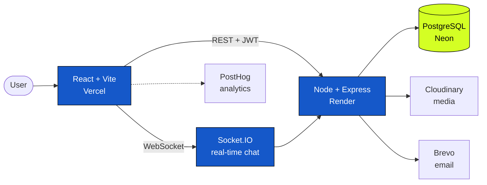
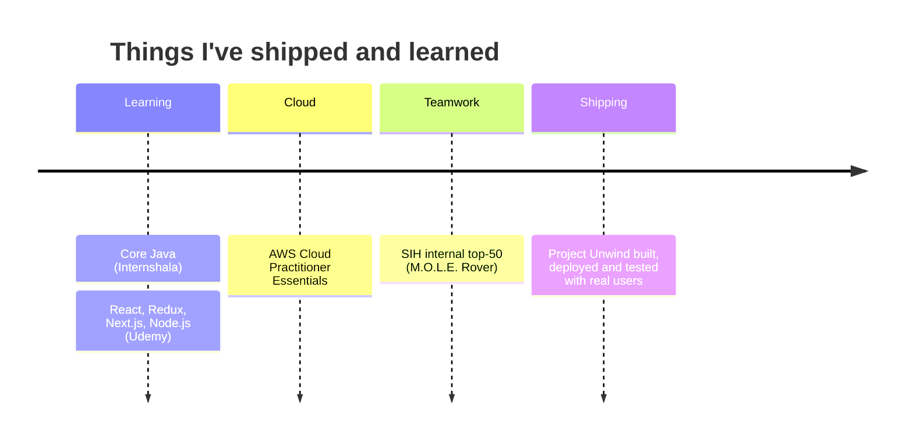

<div align="center">


<a href="https://github.com/AtharvaPadwal2">

</a>

<br/>


<br/><br/>

<a href="mailto:atharvapadwal520@gmail.com"></a>
<a href="https://github.com/AtharvaPadwal2"></a>
<a href="https://project-unwind-mu.vercel.app/"></a>
<a href="https://ar-tifact-six.vercel.app/"></a>

<br/><br/>

**[About](#-about-me)** &nbsp;•&nbsp; **[Projects](#-selected-projects)** &nbsp;•&nbsp; **[Toolbox](#-developer-toolbox)** &nbsp;•&nbsp; **[Stats](#-github-stats)** &nbsp;•&nbsp; **[Milestones](#-learning--milestones)** &nbsp;•&nbsp; **[Contact](#-lets-connect)**

</div>

<br/>

## 👋 About me

```js
const atharva = {
  role: "Information Technology engineering student",
  college: "Atharva College of Engineering, Mumbai",
  mainStack: ["React", "Node.js", "Express", "PostgreSQL"],
  growingIn: ["System design", "Cloud fundamentals", "DevOps", "AI-powered apps"],
  cares: ["Authentication", "Authorization", "Privacy", "API design", "Reliable deployments"],
  practising: "Data structures & algorithms in Java",
  openTo: "Mumbai-based full-stack, frontend and backend internships",
  funOnTheSide: ["Cricket analytics", "Chess", "AR", "Interactive learning"],
};
```

I like taking an idea through the **whole** process: understanding the problem, designing the system, building the frontend and backend, deploying it, and improving it from feedback. I want to understand the application as a whole: how it looks, how it works, how it's secured, and what happens when real people start using it.

<br/>

## 🚀 Selected projects

<table>
<tr>
<td width="50%" valign="top">

### 🌿 [Project Unwind](https://project-unwind-mu.vercel.app/)
**A privacy-first, non-medical mental wellness platform.**

Journaling, wellness tracking, self-reflection and community support in one app. I lead development; teammates contribute to the AI companion, frontend and offline session operations.

`React` `Vite` `Node.js` `Express` `PostgreSQL` `Neon` `Socket.IO` `JWT` `Cloudinary` `Brevo` `PostHog` `Vercel` `Render`

[](https://project-unwind-mu.vercel.app/)

</td>
<td width="50%" valign="top">

### 🛋️ [ARTifact](https://ar-tifact-six.vercel.app/)
**An AR furniture exploration and visualization app.**

Discover furniture and preview 3D models in your own space through an AR-enabled interface, with a catalog and a workspace/history area.

`React` `Vite` `model-viewer` `Node.js` `Express` `MongoDB Atlas` `Appwrite` `Razorpay` `Vercel` `Render`

[](https://ar-tifact-six.vercel.app/)

</td>
</tr>
<tr>
<td width="50%" valign="top">

### ♟️ ChessRAG
**Learn chess, explore openings, play Stockfish.**

RAG-powered tutor with retrieved lesson citations, **2,803** opening records, **19,113** validated games, four Stockfish difficulty levels, and interactive 2D/3D boards.

`Vue 3` `Three.js` `FastAPI` `Stockfish` `Supabase` `pgvector` `FastEmbed` `Groq`

</td>
<td width="50%" valign="top">

### 📓 Journal Insights
**An NLP experiment for emotions in journal-style text.**

Emotion classification, sentiment, keywords and reflection prompts, with a Streamlit interface. Tuned TF-IDF + LinearSVC reached **90.64%** validation accuracy.

`Python` `scikit-learn` `TF-IDF` `LinearSVC` `Streamlit` `NLP`

</td>
</tr>
</table>

<details>
<summary><b>🌿 Project Unwind: what I built, and the architecture</b></summary>

<br/>

| Area | What I've worked on |
|:--|:--|
| 🔑 **Accounts & access** | Email verification, password recovery, Google OAuth, access/refresh token flows, protected routes |
| 📔 **Private journaling** | Journal lifecycle management and PIN-based journal locking |
| 📈 **Wellness tools** | Mood, sleep, habit, energy and water trackers; DASS-21 self-assessment and PDF output |
| 💬 **Community** | Posts, comments, likes, real-time chat, direct messaging, reporting workflows |
| 🛡️ **Administration** | User and report management, decision workflows, testimonials, audit logs |
| 📊 **Product operations** | Analytics, health monitoring, deployment, iterative fixes from tester feedback |
| 📅 **Session workflows** | Booking requests, approve/decline flows, scheduling, session-handler tools |



> **What it taught me:** shipping features is only part of the work. Handling sessions, permissions, database limits, real-time connections and user feedback has been just as valuable.

<sub>Unwind is a wellness companion, not a medical diagnosis or treatment service. AI companion development is a team effort.</sub>

</details>

<details>
<summary><b>🛋️ ARTifact: details</b></summary>

<br/>

- Built around a furniture catalog, 3D/AR viewing and a workspace/history experience.
- React, Vite and Google's `model-viewer` for interactive model presentation.
- Node.js/Express backend with MongoDB Atlas and Appwrite storage.
- JWT authentication and Razorpay payments in **test mode**.
- Worked through deployment issues involving CORS, hosting configuration and backend connectivity.

<sub>AR support depends on the device and browser. Generation and payment workflows remain areas of ongoing development.</sub>

</details>

<details>
<summary><b>♟️ ChessRAG: details</b></summary>

<br/>

- RAG-powered chess tutor with retrieved lesson citations.
- Opening exploration across **2,803** opening records; replay across **19,113** validated dataset games.
- Stockfish gameplay with four difficulty settings, move history and undo.
- Interactive 2D and 3D boards, analysis tools, clocks and premoves.
- Supabase authentication; account-owned game saving and completed-game review are under development.

**Stack:** Vue 3 · Vite · Three.js · chess.js · Python · FastAPI · Stockfish · python-chess · Supabase · PostgreSQL · pgvector · FastEmbed · Groq / OpenRouter

<sub>Developed and tested locally; production deployment is a separate milestone.</sub>

</details>

<details>
<summary><b>📓 Journal Insights: results</b></summary>

<br/>

| Experiment | Validation accuracy | Validation macro F1 |
|:--|:--:|:--:|
| TF-IDF + Logistic Regression | 83.30% | 0.7550 |
| Tuned TF-IDF + LinearSVC | **90.64%** | **0.8813** |

Trained on the `dair-ai/emotion` dataset (six labels), with a Streamlit interface for sentence-level and overall insights. Also explored RoBERTa and VADER for sentiment.

<sub>These are dataset validation results, not evidence of clinical accuracy or real-world journal performance.</sub>

</details>

<details>
<summary><b>🧪 More things I've built or explored</b></summary>

<br/>

| Project / exploration | Focus |
|:--|:--|
| 🏏 **RR Scouting Intelligence** *(in development)* | Local cricket scouting dashboard: Python, Streamlit, Pandas, role-based scoring, explainable comparisons |
| 🤖 **M.O.L.E. Rover** *(team concept & prototype)* | Mine mapping and emergency response; sensors, navigation concepts, TypeScript/Vite dashboard; **SIH internal top-50** |
| 🎯 **BallTrace DRS** *(prototype)* | Cricket ball tracking API experiments with FastAPI and a frontend overlay |
| ☕ **DSA in Java** | Arrays, strings, searching, sorting, continued practice |
| ⚙️ **DevOps practice** | Git workflows, CI/CD, containers, infrastructure automation, college lab exercises |
| 🧩 **Smaller builds** | Mini Projects, Chat app, Photobooth, Full-stack Todo, Pawdcast PetCare, Hospitality Management System |

</details>

<br/>

## 🧰 Developer toolbox

<div align="center">


<sub>Tools I've used, practised, or started exploring, at different levels of experience.</sub>

</div>

<br/>

<details open>
<summary><b>💻 Development & data</b></summary>

<br/>

| Area | Technologies and concepts |
|:--|:--|
| **Languages** | JavaScript, Java, Python, SQL, HTML, CSS; exploring TypeScript |
| **Frontend** | React, Vite, Vue 3, React Router, responsive interfaces, forms, state and component design |
| **Backend & APIs** | Node.js, Express, FastAPI, REST APIs, Socket.IO, Uvicorn |
| **Databases** | PostgreSQL, Neon, Supabase, MongoDB Atlas, pgvector |
| **Authentication** | JWT access/refresh tokens, httpOnly cookies, bcrypt, Google OAuth 2.0, Supabase Auth |
| **API protection** | Zod, Helmet, CORS, rate limiting, authorization checks, Content Security Policy |
| **Integrations** | Cloudinary, Appwrite, Brevo, Razorpay (test) |
| **3D & interactive** | Three.js, model-viewer, chess.js, Stockfish, python-chess |

</details>

<details>
<summary><b>🧠 AI, ML & analytics</b></summary>

<br/>

| Area | Technologies and concepts |
|:--|:--|
| **Data work** | Pandas, dataset cleaning, exploratory analysis, feature engineering, visualization |
| **Classical ML** | scikit-learn, Logistic Regression, LinearSVC, classification, clustering, validation |
| **NLP** | TF-IDF, emotion classification, sentiment analysis, RoBERTa, VADER |
| **RAG & LLM apps** | Embeddings, FastEmbed, vector search, pgvector, retrieved citations, Groq, OpenRouter |
| **ML interfaces** | Streamlit dashboards and local prototypes |
| **Team exposure** | Working around an Ollama-based, locally fine-tuned AI companion built by a teammate |

</details>

<details>
<summary><b>🚢 Shipping, monitoring & workflow</b></summary>

<br/>

| Area | Technologies and practices |
|:--|:--|
| **Version control** | Git, GitHub, feature branches, pull requests, merge-conflict resolution |
| **CI/CD** | GitHub Actions workflows and deployment checks |
| **Hosting** | Vercel, Render, Neon, Supabase |
| **Monitoring** | UptimeRobot, PostHog, service health checks, application logs |
| **Performance** | Local k6 load-testing experiments |
| **DevOps labs** | Docker, Ansible, Nginx, Kubernetes/kubectl fundamentals |
| **Cloud** | AWS Cloud Practitioner Essentials: compute, storage, networking, security fundamentals |
| **Process** | Agile/Scrum, Jira, requirements, PRDs, system design, documentation, tester feedback |

</details>

<details>
<summary><b>🌱 Technologies and ideas I'm still growing into</b></summary>

<br/>

- TypeScript and Next.js for future frontend and portfolio work
- Framer Motion and more polished interactive 3D interfaces
- Cloud architecture and production infrastructure design
- Redis caching, scaling strategies and database performance
- Stronger testing practices and observability
- Deeper machine learning foundations and careful evaluation of AI features
- Kubernetes beyond introductory tooling and lab exercises

</details>

<br/>

## 📊 GitHub stats

<div align="center">


<sub>Stats widgets are loaded from external services and may take a moment, or look different over time.</sub>

</div>

<br/>

## 🏆 Learning & milestones



- ☁️ **AWS Cloud Practitioner Essentials:** completed through AWS Training & Certification (a course completion, distinct from the certification exam).
- ⚛️ **React / Redux / Next.js and Node.js:** coursework through Udemy.
- ☕ **Core Java:** coursework through Internshala.
- 🏅 **SIH internal top-50:** team work on the M.O.L.E. Rover concept.
- 🌿 **Project Unwind:** built and deployed with a team, tested with technical and non-technical users, presented in college and innovation settings.

<br/>

## 🎯 What I'm working towards

| | Goal |
|:-:|:--|
| 🏗️ | **Build stronger software:** clearer architecture, better error handling, thoughtful APIs, dependable UX |
| 🔒 | **Understand production:** secure deployments, monitoring, performance, database operations |
| 🧠 | **Apply AI with purpose:** use ML and retrieval where they solve a real problem, and evaluate their limits |
| 📐 | **Keep the fundamentals sharp:** Java DSA, databases, networking, system design |
| 🤝 | **Learn with a team:** internships, feedback, code reviews, collaborative projects |

<br/>

## 🤝 Let's connect

I'm interested in **Mumbai-based software development internships**, practical collaborations, and conversations about building useful products.

| | |
|:--|:--|
| 📧 **Email** | [atharvapadwal520@gmail.com](mailto:atharvapadwal520@gmail.com) |
| 💻 **GitHub** | [github.com/AtharvaPadwal2](https://github.com/AtharvaPadwal2) |
| 🌿 **Project Unwind** | [Visit the application](https://project-unwind-mu.vercel.app/) |
| 🛋️ **ARTifact** | [Explore the application](https://ar-tifact-six.vercel.app/) |
| 📍 **Location** | Mumbai, India |

<!-- Add your verified LinkedIn URL and portfolio URL here when ready. -->
<!-- Visuals use external image services. GitHub may cache them or display them differently over time. -->

<div align="center">

<br/>

<a href="mailto:atharvapadwal520@gmail.com"></a>


</div>
